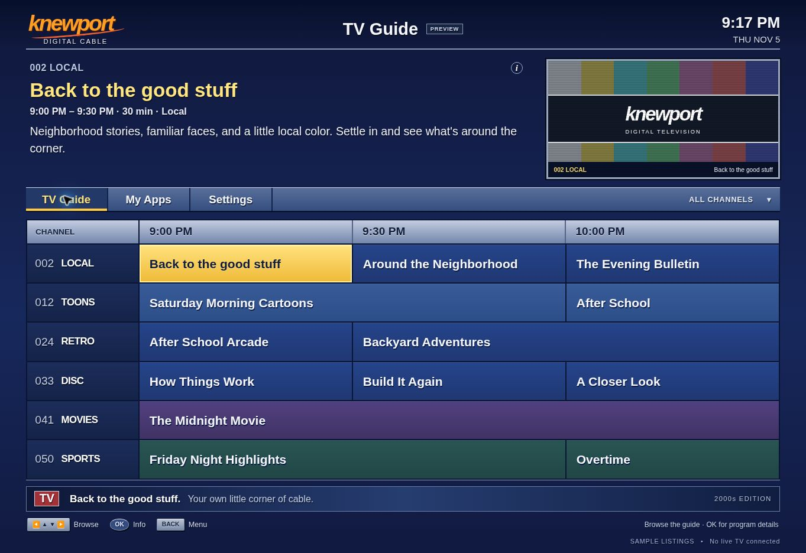

# Home Media Lab

I’m rebuilding my TV around the cable-guide look I grew up with: blue listings, yellow selection, channel numbers, and a remote that does what I expect.

The long-term goal is a TV that boots into my own interface, with a media server I control supplying the channels later. For now, I’m working on the TV side without keeping my everyday PC running as a server. This repo also holds my Windows streaming and troubleshooting work.

[Open the retro guide](https://knewportdev.github.io/home-streaming-lab/) · [Native TV progress](https://github.com/KnewportDev/home-streaming-lab/issues/1) · [Builds](https://github.com/KnewportDev/home-streaming-lab/actions)

*Browser preview of the interface. The program listings are samples.*

## Projects

### Vizio Native

**Node.js · JavaScript · HTML/CSS · Windows/Linux · GitHub Actions**

The TV project starts with a 2000s Suddenlink-style interface and the tools to work out what my VIZIO actually supports. It includes network discovery, pairing, a read-only platform report, offline tests, and a preparation package with file hashes.

The guide works in a browser, and paired TV control has been verified. The TV reports the guide URL as its current app, but its screen and physical remote still need direct verification. Native boot, root access, and replacement firmware are open work.

[Project guide](native-tv/README.md) · [Native-system evidence](native-tv/docs/NATIVE-SYSTEM.md) · [Windows debugging case](native-tv/docs/ENGINEERING-NOTES.md#windows-pairing-state-write-failure) · [Source and tests](native-tv/tools/)

### PC-to-TV streaming
**Windows · PowerShell · Sunshine / Moonlight**

A streaming-host lab covering inventory, network planning, configuration troubleshooting, and session reporting. The clearest case study is a configuration key that looked correct but failed because of a UTF-8 byte-order mark.

[Streaming guide](docs/STREAMING-LAB.md) · [Troubleshooting case](docs/TROUBLESHOOTING-UTF8-BOM.md) · [PowerShell tools](scripts/) · [Validation record](docs/VALIDATION.md)

**Status:** the repository records a verified configuration repair, 20 report-calculation and input-validation checks, and a local PC game benchmark. TV streaming, audio, controller behavior, and end-to-end latency still require testing. Synthetic CSV examples are labeled as sample data.

## Evidence by skill

| Area | Inspect |
| --- | --- |
| Windows fault isolation | [Byte-level configuration diagnosis](docs/TROUBLESHOOTING-UTF8-BOM.md) and [state-file debugging](native-tv/docs/ENGINEERING-NOTES.md) |
| PowerShell automation | [Readiness checker](scripts/Test-HostReadiness.ps1), [report generator](scripts/New-StreamingReport.ps1), [checks](tests/Run-Tests.ps1) |
| Networking | [Bounded discovery](native-tv/tools/inspect-tv.cjs), [LAN proposal](docs/NETWORK-PROPOSAL.md), [stream test plan](docs/TEST-PLAN.md) |
| Repeatable verification | [Offline Node.js tests](native-tv/tools/) and [GitHub Actions definition](.github/workflows/native-tv.yml) |

## Working method

I work in small changes: a branch, a pull request, automated checks, then a test on the actual hardware when the change needs it. I keep the failed attempts and fixes in the engineering notes so I can explain what changed and why. A passing build and a working TV are separate milestones.

The native-TV guide uses the TV’s reported V405-H9 identity. Older streaming notes retain the earlier V405-H19 identification and their original dates.

## Run and read more

- [Native TV local preview and offline tests](native-tv/README.md#start-with-the-local-preview)
- [Streaming tools and full setup notes](docs/STREAMING-LAB.md#run-the-tools)
- [Streaming installation review](docs/INSTALLATION-REVIEW.md)
- [License](LICENSE) · [Native TV license and references](native-tv/README.md#references-and-credits)

Sunshine and Moonlight are separate upstream projects; their source is not bundled here.
