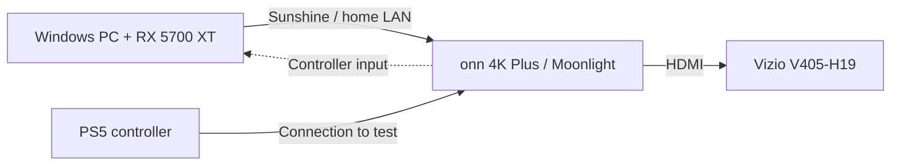

# PC-to-TV streaming lab

A Windows troubleshooting and PowerShell lab built around streaming PC games to a TV.

The goal is to play my PC games on my Vizio TV with a PS5 controller. The lab documents host inventory, network observations, controlled configuration changes, and verification of the results.

Sunshine and ViGEmBus are installed on my Windows PC, and the first local Red Dead Redemption 2 benchmark is recorded below. The TV setup uses an onn 4K Plus (2025) Google TV client with Moonlight. The first TV smoke-test result is still pending.

## Results and status

Last updated: October 11, 2026.

| Check | Recorded result |
| --- | --- |
| Local RDR2 benchmark | **95.35 FPS average**, 32.57 minimum, 139.89 maximum |
| Host software | Sunshine 2026.914.233613 and signed ViGEmBus driver 1.21.442.0 healthy |
| Controller configuration | Xbox 360 virtual-controller output configured; TV input check pending |
| PowerShell report checks | 20/20 passed on Windows PowerShell 5.1, October 10 |
| TV stream | Five-minute smoke-test result pending; audio, video and controller behavior unverified |

The benchmark ran locally on the PC using RDR2's built-in benchmark, with 1920×1080 output, Vulkan, HDR off, Ultra textures, High TAA, High shadows and 16× anisotropic filtering. It was started by holding X for about four seconds.

The minimum is the game's reported minimum FPS, not a 1% low. This run does not measure TV streaming performance, controller-to-display latency, or a locked 60 FPS experience. See the [validation record](docs/VALIDATION.md#local-rdr2-benchmark---october-11) for the setup and limits.

The automated checks cover report calculations and input validation. The example CSV contains synthetic data used to test reporting; its numbers are separate from the local game benchmark. TV testing follows the [first-stream plan](docs/TEST-PLAN.md).

## Start here

- [Troubleshooting case: a UTF-8 BOM in a configuration file](docs/TROUBLESHOOTING-UTF8-BOM.md) - symptom, byte-level diagnosis, minimal repair, and verification from the real setup.
- [Validation record](docs/VALIDATION.md) - what ran, what passed, and what remains untested.
- [Host readiness checker](scripts/Test-HostReadiness.ps1), [report generator](scripts/New-StreamingReport.ps1), and [20-check test runner](tests/Run-Tests.ps1) - inspect the PowerShell work.
- [First-stream test plan](docs/TEST-PLAN.md) - the pending TV, controller, and measured streaming checks.

## The setup



| Part | Current details |
| --- | --- |
| PC | Ryzen 7 5800X, Radeon RX 5700 XT 8 GB, 32 GB RAM (31.9 GiB reported) |
| OS | Windows 11 Pro |
| Host connection | Wi-Fi; Ethernet was disconnected during the inventory |
| TV client | onn 4K Plus (2025) with Moonlight; end-to-end result pending |
| Display | Vizio V405-H19, user-confirmed; HDMI baseline still to test |
| Controller | PS5 DualSense; Xbox 360 virtual output configured on the host, TV input check pending |

The planned first-stream baseline is H.264, 1080p, 60 FPS and SDR. Record the actual bitrate and duration, then change one setting at a time. These stream settings remain a test target.

This first build stays on the home network. See the [LAN proposal](docs/NETWORK-PROPOSAL.md) for the proposed firewall scope and rollback steps.

## What's in this repo

- `scripts/Test-HostReadiness.ps1` checks hardware, network adapters, and Sunshine-related service and firewall state.
- `scripts/New-StreamingReport.ps1` turns a session CSV into a Markdown report.
- `tests/Run-Tests.ps1` checks the report calculations and input validation.
- `examples/` has a blank CSV header and clearly labeled sample rows.
- `docs/` holds the installation review, network proposal, test plan, troubleshooting case and validation record.

The scripts don't install software or change network settings. The readiness checker uses read-only queries and writes a JSON file only when an output path is supplied. It leaves out hostnames, IP and MAC addresses, SSIDs, usernames, and serial numbers. A check it can't complete is marked unknown.

## Run the tools

Use Windows PowerShell 5.1 with its built-in CIM and network cmdlets. No extra PowerShell modules are needed. Run these from the repository folder when your execution policy permits it; don't weaken a managed policy to run the project.

```powershell
.\scripts\Test-HostReadiness.ps1 -OutputPath .\results\host-inventory.local.json
.\tests\Run-Tests.ps1
.\scripts\New-StreamingReport.ps1 -CsvPath .\examples\sample-sessions.csv -OutputPath .\results\sample-report.md
```

The report generator rejects mixed sample and measured data, duplicate run IDs, invalid values, and extra columns. Blank metrics stay blank. Its medians summarize the recorded runs, not individual frames or packets.

## Log a real session

Follow the [first-stream checklist](docs/TEST-PLAN.md). Copy the header from `examples/blank-session.csv` into a CSV under `results/`, which is excluded from Git.

Use `data_kind=measured` only for a real session. Keep the sample rows labeled `sample`.

Required fields:

- `data_kind`, `test_id`, and `codec` (`H264`, `HEVC`, or `AV1`)
- `width`, `height`, `target_fps`, and `bitrate_mbps`
- `duration_seconds` and `controller_check` (`pass`, `fail`, or `pending`)

The four metric fields can be blank: `average_fps`, `network_latency_ms`, `decode_latency_ms`, and `dropped_frames_percent`. Keep those columns in the CSV even when you don't have a value. Use a decimal point for numbers and a simple run ID such as `baseline_01`.

Record only what the overlay actually provides. Network latency and decode latency are separate measurements; neither is full controller-to-display latency. Review any results or screenshots for private information before publishing them.

## Credits

The helper scripts and documentation are included here. Sunshine and Moonlight are separate projects with their own licenses; their code isn't bundled in this repo.

- [Sunshine](https://github.com/LizardByte/Sunshine) by LizardByte and contributors
- [Sunshine setup docs](https://docs.lizardbyte.dev/projects/sunshine/latest/md_docs_2getting__started.html)
- [Moonlight setup guide](https://github.com/moonlight-stream/moonlight-docs/wiki/Setup-Guide)

The helper code is [MIT licensed](LICENSE).
