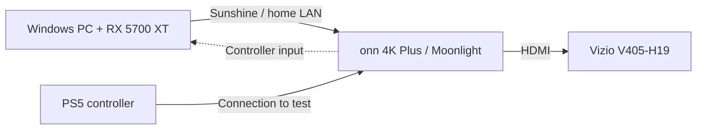

# PC-to-TV streaming lab

A Windows troubleshooting and PowerShell lab built around streaming PC games to a TV.

The goal is to play my PC games on my Vizio TV with a PS5 controller. The lab documents host inventory, network observations, controlled configuration changes, and verification of the results.

Sunshine and ViGEmBus are installed and running on my Windows PC. Moonlight will run at the TV. The client is an onn 4K Plus (2025) Google TV device, now purchased. Configuration validation, TV pairing, controller checks, and the first end-to-end stream are still pending.

## Where it stands

- **Report checks:** All 20 automated checks passed on Windows PowerShell 5.1 on October 10, 2026. They cover report calculations and input validation; they are not streaming/controller tests or a comprehensive test suite for the host readiness checker. The host inventory ran, and the sample report was generated.
- **Still to do:** Validate the configuration, set up and pair the TV client, test the controller, and record the first real stream.
- **Sample data only:** The example CSV uses made-up numbers to test the report. It says nothing about this PC's streaming performance.

The [validation notes](docs/VALIDATION.md) have the runtime details and host observations. The [installation review](docs/INSTALLATION-REVIEW.md) covers the MSI option for skipping its broad firewall exclusions and the separate controller-driver decision. Sunshine and ViGEmBus installation is complete; configuration validation and real streaming tests remain pending.

## Start here

- [Troubleshooting case: a UTF-8 BOM in a configuration file](docs/TROUBLESHOOTING-UTF8-BOM.md) - symptom, byte-level diagnosis, minimal repair, and verification from the real setup.
- [Validation record](docs/VALIDATION.md) - what ran, what passed, and what remains untested.
- [Host readiness checker](scripts/Test-HostReadiness.ps1), [report generator](scripts/New-StreamingReport.ps1), and [20-check test runner](tests/Run-Tests.ps1) - inspect the PowerShell work.
- [First-stream test plan](docs/TEST-PLAN.md) - the pending TV, controller, and measured streaming checks.

## The setup



| Part | Current details |
| --- | --- |
| PC | Ryzen 7 5800X, Radeon RX 5700 XT, 31.9 GiB memory |
| OS | Windows 11 Pro |
| Host connection | Wi-Fi; Ethernet was disconnected during the inventory |
| TV client | onn 4K Plus (2025), purchased; setup pending |
| Display | Vizio V405-H19, user-confirmed; HDMI baseline still to test |
| Controller | PS5 DualSense; connection and in-game input still to test |

The first test will use H.264, 1080p, 60 FPS, and SDR. I'll record the bitrate and change one setting at a time after that. These are starting settings, not measured results.

This first build stays on the home network. See the [LAN proposal](docs/NETWORK-PROPOSAL.md) for the proposed firewall scope and rollback steps.

## What's in this repo

- `scripts/Test-HostReadiness.ps1` checks hardware, network adapters, and Sunshine-related service and firewall state.
- `scripts/New-StreamingReport.ps1` turns a session CSV into a Markdown report.
- `tests/Run-Tests.ps1` checks the report calculations and input validation.
- `examples/` has a blank CSV header and clearly labeled sample rows.
- `docs/` holds the installation review, network proposal, test plan, and validation record.
- `profile/` is a separate GitHub profile README and matching header. [Setup instructions](SETUP.md) explain where it goes.

The scripts don't install software or change network settings. The readiness checker uses read-only queries and writes a JSON file only when an output path is supplied. It leaves out hostnames, IP and MAC addresses, SSIDs, usernames, and serial numbers. A check it can't complete is marked unknown.

## Run the tools

Use Windows PowerShell 5.1 with its built-in CIM and network cmdlets. No extra PowerShell modules are needed. Run these from the repository folder when your execution policy permits it; don't weaken a managed policy to run the project.

```powershell
.\scripts\Test-HostReadiness.ps1 -OutputPath .\results\host-inventory.local.json
.\tests\Run-Tests.ps1
.\scripts\New-StreamingReport.ps1 -CsvPath .\examples\sample-sessions.csv -OutputPath .\results\sample-report.md
```

The report generator rejects mixed sample and measured data, duplicate run IDs, invalid values, and extra columns. Blank metrics stay blank. Its medians summarize the recorded runs, not individual frames or packets.

## Log a real session

Follow the [first-stream checklist](docs/TEST-PLAN.md). Copy the header from `examples/blank-session.csv` into a CSV under `results/`, which is excluded from Git.

Use `data_kind=measured` only for a real session. Keep the sample rows labeled `sample`.

Required fields:

- `data_kind`, `test_id`, and `codec` (`H264`, `HEVC`, or `AV1`)
- `width`, `height`, `target_fps`, and `bitrate_mbps`
- `duration_seconds` and `controller_check` (`pass`, `fail`, or `pending`)

The four metric fields can be blank: `average_fps`, `network_latency_ms`, `decode_latency_ms`, and `dropped_frames_percent`. Keep those columns in the CSV even when you don't have a value. Use a decimal point for numbers and a simple run ID such as `baseline_01`.

Record only what the overlay actually provides. Network latency and decode latency are separate measurements; neither is full controller-to-display latency. Review any results or screenshots for private information before publishing them.

## Credits

The helper scripts and documentation are included here. Sunshine and Moonlight are separate projects with their own licenses; their code isn't bundled in this repo.

- [Sunshine](https://github.com/LizardByte/Sunshine) by LizardByte and contributors
- [Sunshine setup docs](https://docs.lizardbyte.dev/projects/sunshine/latest/md_docs_2getting__started.html)
- [Moonlight setup guide](https://github.com/moonlight-stream/moonlight-docs/wiki/Setup-Guide)

The helper code is [MIT licensed](LICENSE).
