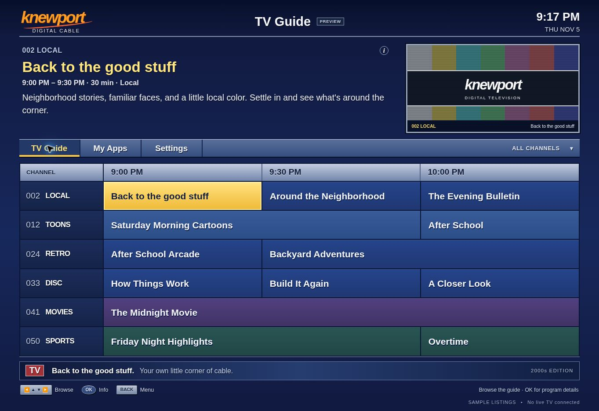

# Vizio Native

A native TV overhaul for the VIZIO V405-H9: boot into a personal retro cable guide, run locally on the set, and eventually connect to a self-hosted media server.

The interface takes its cues from 2000s Suddenlink cable guides and classic i-Guide: blue listings, yellow selection, silver time headers, program details, and a bordered preview pane. The project has its own branding and implementation.

[Public preview](https://knewportdev.github.io/home-streaming-lab/) · [Source](https://github.com/KnewportDev/home-streaming-lab/tree/main/native-tv) · [Native-system issue #1](https://github.com/KnewportDev/home-streaming-lab/issues/1) · [MIT license](LICENSE)



*Browser preview; schedule listings are samples.*

## Where it stands

The cable guide is published on GitHub Pages and works in a desktop browser. PIN pairing and authenticated launch requests work with the TV. The repository now includes native capability inspection and interface packaging for the next stage.

| Part | Status |
| --- | --- |
| Cable-guide interface | Browser-verified layout, directional navigation, program dialogs, Settings, and empty My Apps state. |
| TV control | PIN pairing completed. An authenticated current-app read reported Conjure app 17, namespace 4, and the public guide URL. |
| Native preparation | A bounded, read-only platform report and an interface bundle with a SHA-256 manifest. |
| Source release | Publisher archive acquired, both published checksums matched, and selected Home, updater, and MT5691 build source inspected. [Findings and evidence](docs/SOURCE-INSPECTION.md); exact installed-build compatibility remains unverified. |
| Local network report | Seven passive reads completed on 6 November: the TV reported connected; connection type remains unknown. [Redacted evidence](docs/evidence/native-network-2026-11-06.json). |
| TV Check page | Published and checked in a desktop browser. Paired TV launch and exact current-app URL verified; physical TV receipts remain pending. |
| Physical TV behavior | Screen rendering and physical remote behavior still need observation on the TV. |
| Native system | Root, backup/restore, bootloader control, internal installation, and permanent Home replacement remain unverified. |
| Media and schedules | Sample listings only; no television feed, playback source, or real program-guide data is connected. |

[PR #5](https://github.com/KnewportDev/home-streaming-lab/pull/5) merged with **88 Linux tests and 87 Windows tests** passing in both [PR validation](https://github.com/KnewportDev/home-streaming-lab/actions/runs/42158990637) and [main run 42159281900](https://github.com/KnewportDev/home-streaming-lab/actions/runs/42159281900). The main run also published Pages. The [workflow](https://github.com/KnewportDev/home-streaming-lab/actions/workflows/native-tv.yml) reports results for each revision.

The full native system is the goal. The current interface and preparation bundle are not a replacement OS or firmware installer. [Native-system evidence](docs/NATIVE-SYSTEM.md) records the compatibility gaps and the steps needed to close them.

## Target hardware

The live API returned these values on 5 November 2026:

| Field | Value |
| --- | --- |
| Model | V405-H9 |
| System firmware | `1.720.9.1-1` |
| ViziOS build | `mtk5691-1.6.1770.1` |
| SmartCast API | `3.9.1-2640.0002` |
| Conjure / Home | `128.1.9` / `26.09.01.21` |

Earlier H19 notes were superseded by this live identity. The session tools check the model and exact firmware before actions. API access and an accepted launch establish the control path; the TV screen remains a separate check.

## Start with the local preview

Use **Node.js 24**. No package installation is required. From `native-tv/`:

```sh
node tools/preview-home.cjs
```

Open [http://127.0.0.1:8138](http://127.0.0.1:8138). Arrows move through the guide, Enter opens program information, and Back/Escape closes a dialog or opens Settings. Guide and My Apps switch views.

A fresh clone uses `home/config.example.json`. Personal settings belong in the ignored `home/config.json`. The public preview and preparation bundle use the shared example, with an empty app catalog and native app controls disabled.

[TV setup](docs/TV-SETUP.md) covers discovery, reuse of an existing paired session, HTTPS launch, optional local serving, and pairing recovery. [Interface documentation](home/README.md) covers controls, themes, and configuration.

The public HTTPS guide needs no PC serving its assets. A personal media server and continuous channels come later; there is no requirement to keep a PC running now.

## Project layout

| Path | Purpose |
| --- | --- |
| `home/` | The cable guide, My Apps, Settings, and standalone `tv-check.html`. Assets stay local; no external fonts or analytics. |
| `tools/inspect-tv.cjs` | Bounded SSDP discovery and fixed GET-only metadata requests. |
| `tools/native-session.cjs` | PIN pairing, private session state, and authenticated Conjure launch requests. |
| `tools/inspect-native-platform.cjs` | Read-only capability inspection using an already paired session; optional passive network-status reads. |
| `tools/package-native-home.cjs` | Packages the interface, shared configuration, instructions, license, and content manifest. |
| `tools/verify-source-bundle.cjs` | Reads a downloaded source ZIP and compares pinned publisher digests without extracting or executing it. |
| `tools/make-usb-diagnostic.cjs` | Prepares a fixed read-only CGI diagnostic; does not contact or execute anything on a TV. |
| `tools/preview-home.cjs` | Local development preview. |
| `docs/` | Setup, engineering notes, native-system evidence, and a portfolio summary. |

## Native preparation

Reuse the existing private paired state. Do not start pairing again for an inspection:

```sh
node tools/inspect-native-platform.cjs --state ABSOLUTE_PRIVATE_FILE
```

The inspector reads a fixed set of informational endpoints and produces a redacted report. All four requests completed successfully on the target TV; the [redacted device report](docs/evidence/native-platform-2026-11-06.json) records the observed result. It does not install software or infer root from control-API access.

Add `--network` for exactly three more passive reads:

```sh
node tools/inspect-native-platform.cjs --state ABSOLUTE_PRIVATE_FILE --network
```

The [seven-read report](docs/evidence/native-network-2026-11-06.json) records `reportedConnected: true` and an unrecognized connection type, retained as `unknown`. No TV writes were sent. Local connection status does not verify DNS, TLS, Internet access, or page rendering. Missing or malformed values stay unknown rather than becoming a disconnected result.

Build an interface bundle into a new or empty output directory:

```sh
node tools/package-native-home.cjs --out native-home-package
```

The eight-file bundle preserves the cable-guide design and includes TV Check, shared configuration, and a SHA-256 manifest. Native app controls stay disabled. The guide's origin guard is a project policy, not a measured restriction of this H9 firmware. The bundle contains no firmware image or installation routine.

## TV Check: observe execution on the screen

[TV Check](https://knewportdev.github.io/home-streaming-lab/tv-check.html) is published as a standalone page ([source](home/tv-check.html)). **Page: Open**, **JavaScript: Running**, and the **Remote** key receipt separate page rendering, script execution, and delivered key events. Desktop review observed those page/script receipts, arrow-key receipt and focus changes, no automatic local request, and OK on Back returning to the original guide. [Engineering notes](docs/ENGINEERING-NOTES.md#passive-network-status-and-visible-execution-checks--6-november-2026) include the desktop screenshot. The page uses no credentials.

Its optional **Check TV connection** button makes one fixed, unauthenticated GET to `http://127.0.0.1:7346/state/device/deviceinfo`, bounded to 3 seconds and 128 KiB. Browser status `0` is ambiguous; it does not mean “no Internet.” This check neither enables the guide's native controls nor establishes root or persistence.

The TV accepted its launch using the existing paired state. At **2026-11-06 03:23:03 UTC**, authenticated `/app/current` matched app 17, namespace 4, and the exact public TV Check URL; the [launch report](docs/evidence/tv-check-launch-2026-11-06.json) records that result. This remains launch metadata, not a screenshot or execution receipt. The check now shows a short **`K1-...` result code**: send that code or a photo from the actual TV after pressing Left and OK. It is not a pairing PIN or build identifier. [Setup instructions](docs/TV-SETUP.md#tv-check-visible-execution-receipts) explain the values. Physical screen rendering, physical remote behavior, and the optional Local API result remain pending.

## Matching source release

The published **5691 / FUR7.2** release lists `1.720.X.Y`, matching the observed firmware family. On 6 November 2026, the publisher archive was downloaded to the development PC and both published checksums matched. The ZIP is 7,946,973,901 bytes; its [receipt](docs/evidence/source-archive-2026-11-06.json) records SHA-256 and the pinned publisher references without personal details.

[Direct source inspection](docs/SOURCE-INSPECTION.md) now covers Home selection, updater verification, and the `mt5691_cast` board-support target. The Home controller matters: a URL setting alone does not establish a working replacement. The ViziOS build script also selects `mtk5695`, while the separate MT5691 BSP selects `m7632`; that relationship needs to be resolved before using generated output on the TV. Vendor programs have not been run, and no vendor source is included in this repository.

To verify another local copy, run the dependency-free verifier with an absolute path:

```sh
node tools/verify-source-bundle.cjs --archive ABS_ZIP --out ABS_NEW_JSON
```

It reads in bounded chunks, compares both published checksums, and records SHA-256 for future comparisons. The report omits personal paths, refuses overwrite, and leaves installation eligibility unverified. This step does not unpack or run vendor code. [Source intake](docs/SOURCE-INTAKE.md) documents verification and private handling. The source-verifier and result-code regressions bring the suite to **88 Linux / 87 Windows tests**, with zero failures or skips in the recorded hosted run above.

## Develop and verify

```sh
node --check home/home.js
node --test tools/test-inspect-tv.cjs tools/test-native-session.cjs tools/test-usb-diagnostic.cjs tools/test-home-guide.cjs tools/test-inspect-native-platform.cjs tools/test-package-native-home.cjs tools/test-tv-check.cjs tools/test-verify-source-bundle.cjs
```

Tests use synthetic responses, mocked transports, loopback servers, and temporary files. They do not contact the TV. The POSIX USB script is checked on Linux; the other Node suites also run in the Windows workflow job.

The repository-root workflow is `.github/workflows/native-tv.yml`:

1. Work on a focused branch and open a pull request.
2. Run the offline Linux and Windows checks.
3. Attach an allowlisted preview ZIP and a native preparation bundle to successful runs. Artifacts are retained for 14 days.
4. Publish the browser preview to Pages only after the required jobs pass on `main`. PRs and manual builds provide artifacts without publishing.
5. Record physical TV checks against the matching revision before describing any behavior as installed or working on the set.

The preview contains seven shared files: `index.html`, `home.css`, `home.js`, `tv-check.html`, example-derived `config.json`, the interface README, and the MIT license. The native preparation bundle adds its content manifest for eight files. Pairing state and personal configuration stay out of artifacts and Pages. CI has no TV credentials or device access.

[Contributing](CONTRIBUTING.md) · [Project conventions](AGENTS.md) · [Engineering notes](docs/ENGINEERING-NOTES.md) · [Portfolio summary](docs/PORTFOLIO.md)

## Next stages

- Photograph TV Check's receipts on the television, verify physical remote input, then check the guide's navigation, Settings, and return behavior.
- Establish a native execution path for this exact firmware, then obtain a backup and a tested recovery route.
- Run the interface locally on the TV before attempting a reversible persistent Home change.
- Pursue a complete system replacement only with a verified boot path and working support for the panel, inputs, sound, storage, networking, and power control.
- Add a self-hosted server for personal media, channel schedules, and guide data in a later phase.

These stages are tracked in [issue #1](https://github.com/KnewportDev/home-streaming-lab/issues/1). A permanent native home and a complete replacement system are separate milestones. No matching root method, restore procedure, or complete replacement image is verified for this target yet.

## References and credits

- [Classic i-Guide manual](https://www.wadsworthcity.com/DocumentCenter/View/1540/I-Guide-Manual---Manual-for-the-Digital-Guide-Our-Digital-Settop-Boxes-Use-PDF): visual reference for the cable-guide layout.
- [VIZIO SmartCast app launcher](https://vizio-pm.s3-us-west-1.amazonaws.com/conjure-launcher.html): pairing and Conjure launch behavior.
- [true[X] SmartCast deployment guide](https://github.com/socialvibe/truex-ctv-web-reference-app/blob/develop/platforms/Vizio/README.md) and [SmartCast API documentation](https://github.com/exiva/Vizio_SmartCast_API): protocol references.
- [Vizio Open Home](https://github.com/jordanmateo-byte/vizio-open-home): native Home work reported on M657-G0 / SX7B / firmware 7.0.120.1-1. That validation does not establish compatibility here.
- [ELTON USB CGI research](https://www.eltoncyber.com/advisories/vizio-tv-code-execution-from-a-usb-drive) and [ViziOwn](https://bh2017.exploitee.rs/2021/viziown-exploiting-vizio-smartcast/): historical research on other device and firmware combinations.

Original project code is [MIT licensed](LICENSE). Upstream work is credited as research and design reference; no third-party firmware, signing keys, or proprietary binaries are bundled.
