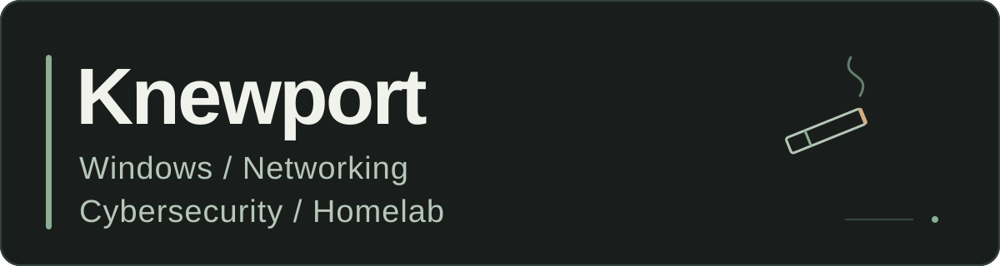

I'm building a home lab around the stuff I actually use. Right now, that's getting PC games onto my TV and figuring out the networking behind it.

### On the workbench

**PC-to-TV streaming lab**

Sunshine on my Windows PC, Moonlight at the TV, and a PS5 controller. The PowerShell checks are tested. Installing the streaming software and testing the first real stream are next.

### What I'm learning

- Windows troubleshooting
- Home networking
- Cybersecurity fundamentals
- Testing a setup and making it repeatable
